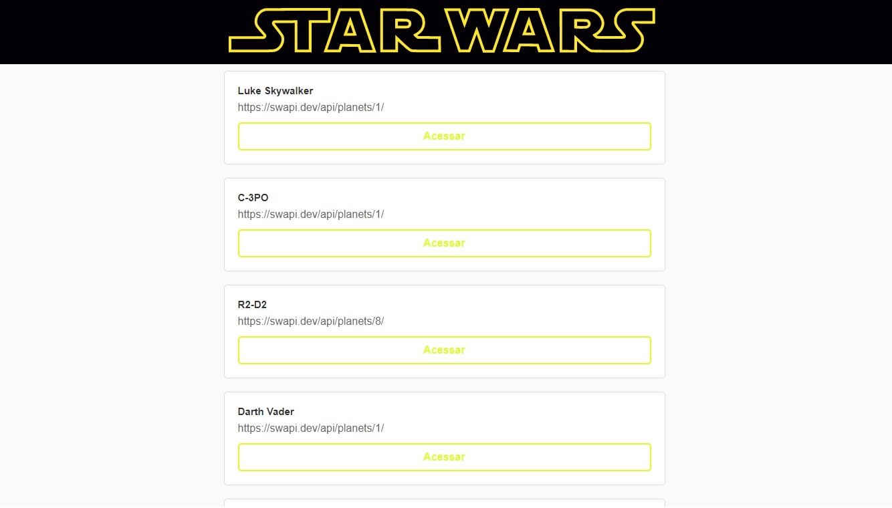
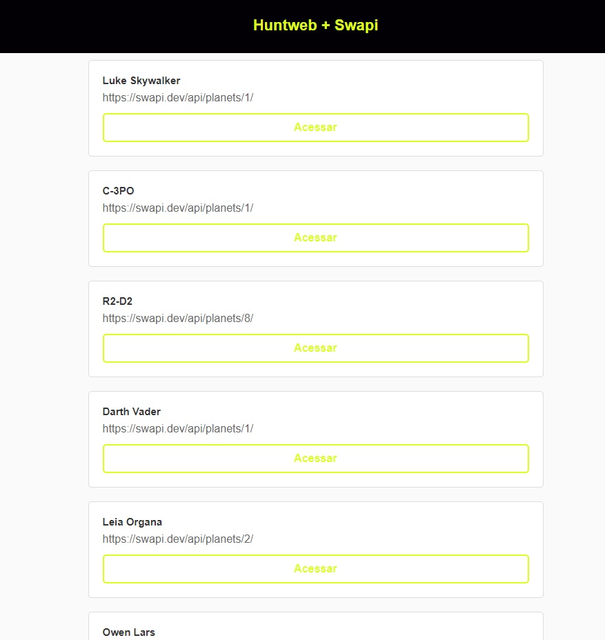
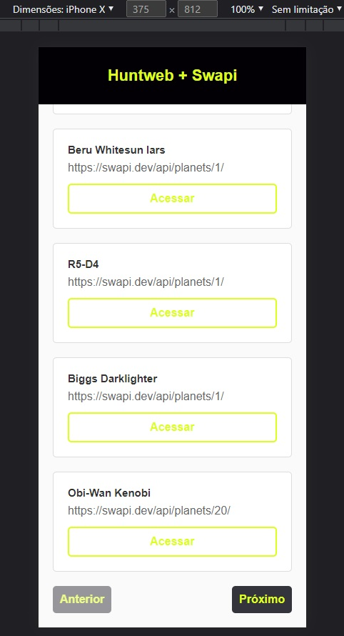
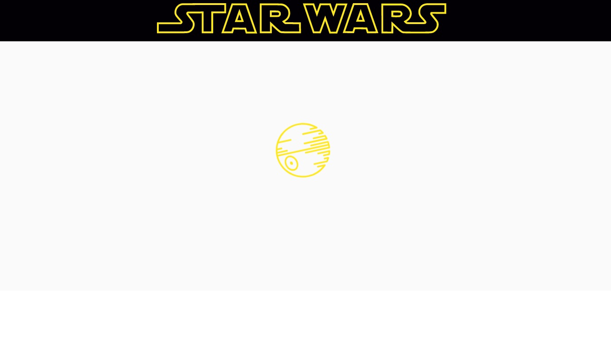
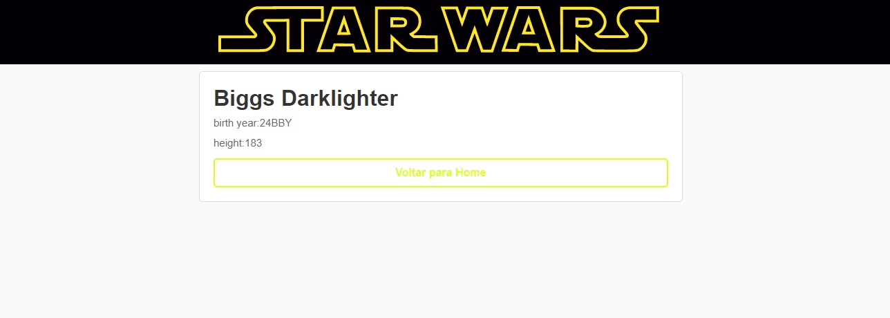
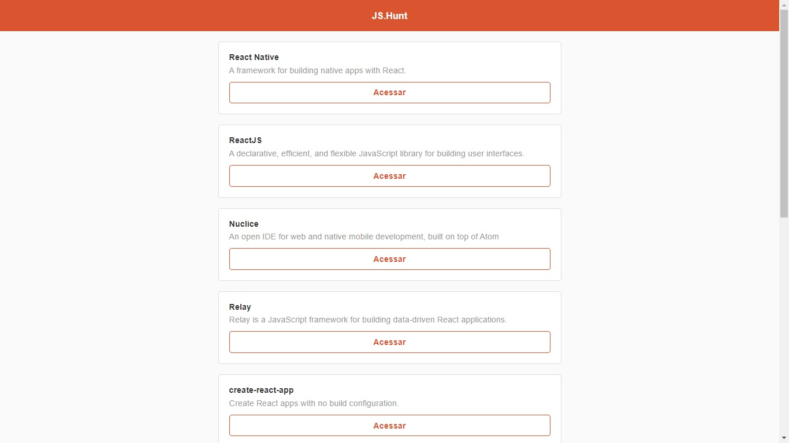

<h1 align="center">
    
</h1>

<h3 align="center">Huntweb SWAPI</h3>

<p align="center">
  Personagens de Star Wars com busca, paginação e detalhe, consumindo a <a href="https://swapi.dev/">SWAPI</a> em React.
</p>

<p align="center">
  <a href="https://github.com/douglasabnovato/huntweb-swapi/actions/workflows/ci.yml"></a>
  
  <a href="LICENSE"></a>
</p>

> **Projeto de estudo (N1).** Nasceu no meu primeiro bootcamp, foi o meu primeiro front-end consumindo uma API e hoje roda em Vite, React 18 e React Router 7, com testes no jsdom e no navegador. O site ainda não está publicado: para ver, rode localmente (seção "Como executar").

## Estado e próximos passos (ciclo de 16/11/2026)

Critérios do MVP (N1): 10 de 10 aplicáveis atendidos em 16/11/2026, Finalizado: sim. Os alertas do Dependabot estão ligados, com 0 abertos em 16/11/2026, depois do merge do #36. Evidência em [docs/MVP.md](docs/MVP.md). A `master` está protegida: só recebe mudanças por PR, com o job `raiz` do CI verde.

Sem site publicado: `https://douglasabnovato.github.io/huntweb-swapi/` respondeu 404 em 16/11/2026, porque o GitHub Pages ainda não foi ligado ([#25](https://github.com/douglasabnovato/huntweb-swapi/issues/25)). O workflow de publicação já está pronto.

**O que foi feito**
- Teste no navegador (Playwright) do fluxo buscar, abrir o detalhe e voltar, só pelo teclado, com axe em cada tela, link direto e SWAPI fora do ar; job `e2e` no CI ([#37](https://github.com/douglasabnovato/huntweb-swapi/pull/37)).
- O axe achou o link "Acessar" com nome acessível diferente do texto visível (WCAG 2.5.3); corrigido ([#37](https://github.com/douglasabnovato/huntweb-swapi/pull/37)).
- Título da aba por página e campo de busca que acompanha a URL ao voltar ([#37](https://github.com/douglasabnovato/huntweb-swapi/pull/37)).
- Dependências de desenvolvimento atualizadas: 9 alertas do Dependabot resolvidos ([#37](https://github.com/douglasabnovato/huntweb-swapi/pull/37)).
- `master` protegida e workflow único com publicação no Pages só em push na `master` ([#35](https://github.com/douglasabnovato/huntweb-swapi/pull/35)).
- Limite de tempo, mensagens de falha da SWAPI, "Tentar de novo" e filmes no detalhe ([#31](https://github.com/douglasabnovato/huntweb-swapi/pull/31)).
- Licença MIT ([#21](https://github.com/douglasabnovato/huntweb-swapi/pull/21)).

**O que queremos fazer**
- [#25](https://github.com/douglasabnovato/huntweb-swapi/issues/25) Ligar o GitHub Pages (responsável).
- [#38](https://github.com/douglasabnovato/huntweb-swapi/issues/38) Exigir o job `e2e` no ruleset da `master` (responsável).
- [#27](https://github.com/douglasabnovato/huntweb-swapi/issues/27) API de reserva quando a swapi.dev cai.
- [#28](https://github.com/douglasabnovato/huntweb-swapi/issues/28) Páginas de planetas, espécies e naves.
- [#39](https://github.com/douglasabnovato/huntweb-swapi/issues/39) Tema escuro que segue o sistema.
- [#40](https://github.com/douglasabnovato/huntweb-swapi/issues/40) ESLint no CI.
- [#41](https://github.com/douglasabnovato/huntweb-swapi/issues/41) Foco no título quando a rota muda.
- [#42](https://github.com/douglasabnovato/huntweb-swapi/issues/42) Validar a hipótese com 3 pessoas no site publicado.

**Onde está a documentação**
- Estado, critérios e hipótese: [docs/MVP.md](docs/MVP.md).
- Plano de cada ciclo, com as fontes da pesquisa: [docs/PLANO-DE-ACAO.md](docs/PLANO-DE-ACAO.md).
- Publicação no GitHub Pages, passo a passo: [docs/DEPLOY.md](docs/DEPLOY.md).
- Arquitetura e decisões: [docs/ARQUITETURA.md](docs/ARQUITETURA.md) e [docs/ANALISE.md](docs/ANALISE.md).

## ✨ O que o app faz

- Lista os personagens de 10 em 10, com planeta natal e ano de nascimento.
- Busca pelo nome; a página e a busca ficam na URL, então voltar do detalhe mantém a posição.
- Detalhe com altura, massa, cores, planeta natal e filmes, em ordem de lançamento.
- Mensagem clara e "Tentar de novo" quando a rede cai, a SWAPI sai do ar ou demora mais de 15 s.
- Navegável pelo teclado, com foco visível, rótulos e título da aba por página.

<p align="center" style="display: flex; align-items: flex-start; justify-content: center;">
  
  
</p>

## 🛠 Tecnologias

| Para quê | O quê |
|---|---|
| Interface | [React 18](https://react.dev) e [React Router 7](https://reactrouter.com) |
| Build e servidor local | [Vite 8](https://vite.dev) |
| Testes de tela e unidade | [Vitest](https://vitest.dev) e [Testing Library](https://testing-library.com) no jsdom |
| Teste no navegador e acessibilidade | [Playwright](https://playwright.dev) e [axe-core](https://github.com/dequelabs/axe-core-npm) |
| Dados | [SWAPI](https://swapi.dev/documentation), com `fetch` nativo e os planetas em `src/data/planets.json` |
| CI e publicação | GitHub Actions e GitHub Pages |

## 🚀 Como executar

Precisa do [Node.js](https://nodejs.org/) 22 ou mais novo.

```bash
git clone https://github.com/douglasabnovato/huntweb-swapi
cd huntweb-swapi
npm ci
npm run dev       # http://localhost:5173
npm test          # testes no Vitest (jsdom)
npm run build     # gera build/ com a base /huntweb-swapi/
npm run preview   # serve o build em http://localhost:4173/huntweb-swapi/
```

Teste no navegador (gera o build e sobe o preview na porta 4317, com a SWAPI simulada):

```bash
npx playwright install chromium   # uma vez
npm run test:e2e
```

A URL da API pode ser trocada em `.env` (`VITE_SWAPI_URL`, modelo em `.env.example`) e, no site publicado, pela variável de repositório `VITE_SWAPI_URL`. Só funciona com uma API no mesmo formato da swapi.dev (lista paginada com `count`, `next`, `results` e busca por `?search=`); veja [docs/DEPLOY.md](docs/DEPLOY.md).

### Publicação

- Hospedagem prevista: GitHub Pages (gratuito), publicado pelo workflow `CI` a cada push na `master`, depois dos jobs `raiz` e `e2e` verdes.
- Hoje fora do ar: falta ligar o Pages ([#25](https://github.com/douglasabnovato/huntweb-swapi/issues/25)). Passo a passo em [docs/DEPLOY.md](docs/DEPLOY.md).

## 🧠 O que aprendi

> Proposta de 01/11/2026, escrita a partir do código e das dependências. Ajuste com a sua experiência.

- Consumir uma API pública e paginar resultados em React.
- Configurar a URL da API por variável de ambiente.
- Navegar entre lista e detalhe com React Router.
- Testar a interface com Vitest e, no navegador, com Playwright e axe.

## 🎨 Versões

### Web v3 (2026): Vite, testes e acessibilidade

- Link do personagem corrigido para qualquer id (antes quebrava em ids de 1 e 3 dígitos).
- Planeta natal pelo nome, busca, página na URL, detalhe com filmes e página 404.
- Falhas da SWAPI tratadas, com limite de tempo e "Tentar de novo".
- Contraste AA, rótulos, foco visível e axe sem violações no CI.
- Detalhes em [docs/ANALISE.md](docs/ANALISE.md) e [docs/PLANO-DE-ACAO.md](docs/PLANO-DE-ACAO.md).

### Web v2.0: SWAPI

- [x] favicon da star wars: insirido as imagens na pasta public
- [x] fluxo da rota
- [x] componente de loader para o elemento people clicado
- [x] paginação de objetos
- [x] estilização de item clicado
- [x] header fixed
- [x] header logo
- [x] tratar paginação no fluxo para page > 1 (Navegação (Roteamento))
- [x] o botão voltar (Navegação (Roteamento))
- [x] [React Router v5](https://v5.reactrouter.com/)
- [x] inspiração [swapi-task](https://finmavis.github.io/swapi-task/)
- [x] inspiração [finmavis-swapi-task](https://github.com/finmavis/swapi-task)
- [x] inspiração [animatk-ReactJS-Star-Wars-API](https://github.com/animatk/ReactJS-Star-Wars-API)

<h5 align="center"> 
	🚀 mudança da api para `https://swapi.dev/api`
</h5>

<p align="center" style="display: flex; align-items: flex-start; justify-content: center;">
  
  
  
  
</p>

### Web v1.0: API do curso

<h5 align="center"> 
	🚀 api `http://rocketseat-node.herokuapp.com/api`
</h5>

<p align="center" style="display: flex; align-items: flex-start; justify-content: center;">
  
</p>

<details>
<summary>Histórico da versão 1: tópicos do curso (create-react-app, axios e React Router 5, que não estão mais no código)</summary>

#### 1. O que é ReactJS ?

- [x] 1.1. ReactJS construir o Frontend
- [x] 1.2. uma biblioteca para desenvolver em javascript
- [x] 1.3. Acessar API Rest
- [x] 1.4. Roteamento
- [x] 1.5. Componentes
- [x] 1.6. Estados e Propriedades

#### 2. Criando Projeto

- [x] 2.1. `node -v`
- [x] 2.2. `npm -v`
- [x] 2.3. `yarn -v`
- [x] 2.4. `create-react-app huntweb`
- [x] 2.5. `cd huntweb`
- [x] 2.6. `code .`
- [x] 2.7. `npm start`

#### 3. O que são componentes ?

- [x] 3.1. conceito de componentização
- [x] 3.2. react
- [x] 3.3. react-dom 
- [x] 3.4. método do componente: render

#### 4. Criando Header ?

- [x] 4.1. na pasta src, na pasta componentes, na pasta Header, então criar todos arquivos desse componente: index.js
- [x] 4.2. Estilização do component Header: styles.css
- [x] 4.3. Estilização global 

#### 5. Buscando produtos da API 

- [x] 5.1. acessar API Rest feita em nodejs e exibir na nossa tela em ReactJS.
- [x] 5.2. fiz essa api no repositório nodejs-api
- [x] 5.3.1. essa API Rest fornece o dados dos produtos: id, title, description, url, ( createdAt, não será exibido) 
- [x] 5.3.2. informações de paginação: docs, total, limit, page, pages
- [x] 5.4. biblioteca axios: `yarn add axios`: permite acessar um endereço externo: pasta services/api.js
- [x] 5.5. A URL da nossa API: `http://rocketseat-node.herokuapp.com/api`
- [x] 5.6. Insomnia: usar essa aplicação para gerir os dados da api
- [x] 5.7. Na api, os produtos estão dentro da informação `docs` 
- [x] 5.8. A busca dessas informações na api será realizada pelo main/index.js.

#### 6. Armazenamento no estado

- [x] 6.1. state, estado, acredito ser o principal conceito do reactjs
- [x] 6.2. o react trabalha com variável state e não variável normal. 
- [x] 6.3. o `estado` trabalha em manipular a variável objeto

#### 7. Listando produtos

- [x] 7.1. estilizar a exibição dos produtos

#### 8. Páginas anterior / próxima

- [x] 8.1. fazer a paginação dos produtos
- [x] 8.2. criar os botões: anterior e próximo
- [x] 8.3. estilização dos botões
- [x] 8.4. chamar um método toda vez que o usuário clicar no botão

#### 9. Configurando Navegação (Roteamento)

- [x] 9.1. Usar rotas para a navegação: `yarn add react-router-dom`
- [x] 9.2. Componente de detalhes dos produtos: browserrouter, switch, route 
- [x] 9.3. Redirecionar o usuário conforme cada rota
- [x] 9.4. Componente Link para cada um dos botões

#### 10. Navegando para o detalhe

- [x] 10.1. Buscar os dados dos produtos da API Rest
- [x] 10.2. Exibir em tela na pages products
- [x] 10.3.1. state
- [x] 10.3.2. async await
- [x] 10.3.3. props 
- [x] 10.3.4. componentdidmount
- [x] 10.4. Estilização da product info

</details>

## 😯 Como contribuir

1. Faça um **fork** do projeto.
2. Crie uma branch com as suas alterações: `git checkout -b minha-feature`
3. Rode `npm test` e `npm run test:e2e`.
4. Faça o commit contando o que você fez: `git commit -m "feat: minha feature"`
5. Envie e abra um pull request: `git push origin minha-feature`

> Dúvidas sobre o fluxo? Veja este [guia de como contribuir no GitHub](https://github.com/firstcontributions/first-contributions).

## 📝 Licença

Este projeto está sob a licença [MIT](LICENSE).

Feito com ❤️ por Douglas A B Novato 👋🏽 [Entre em contato!](https://www.linkedin.com/in/douglasabnovato/)

Fonte do projeto: [Rocketseat Discover - ReactJS](https://www.rocketseat.com.br/)
