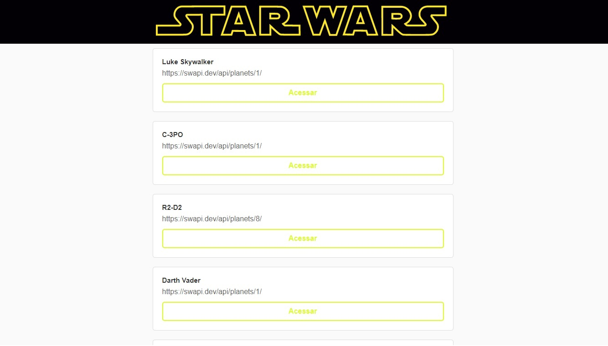
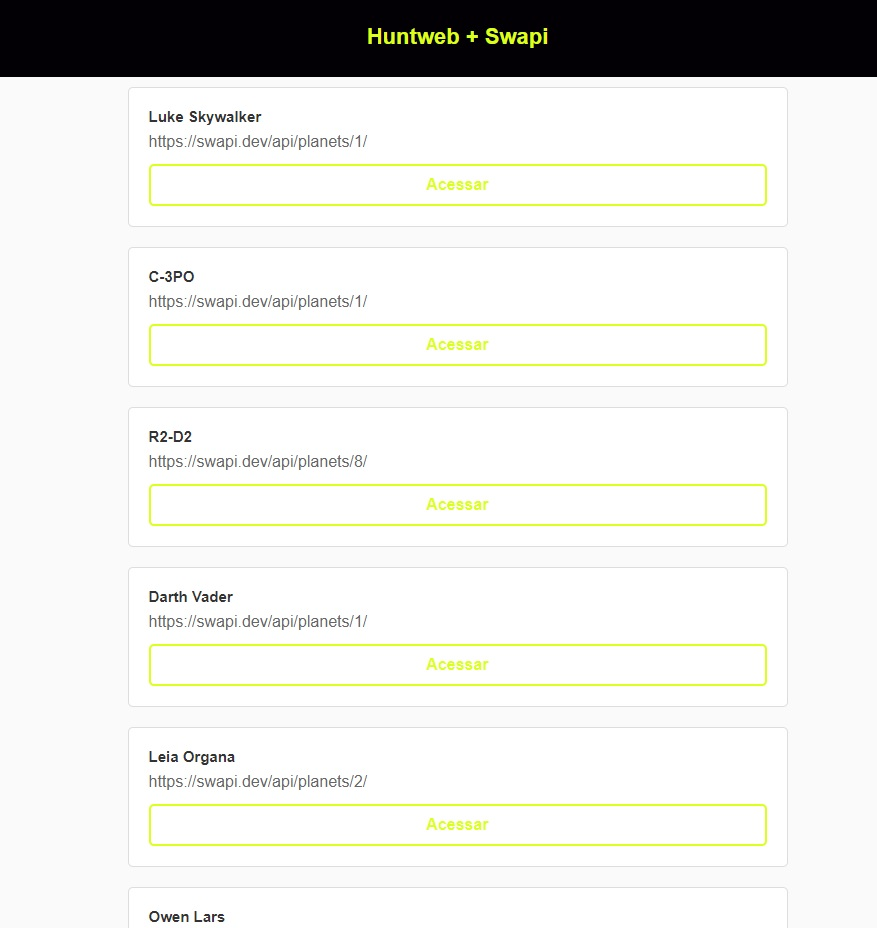
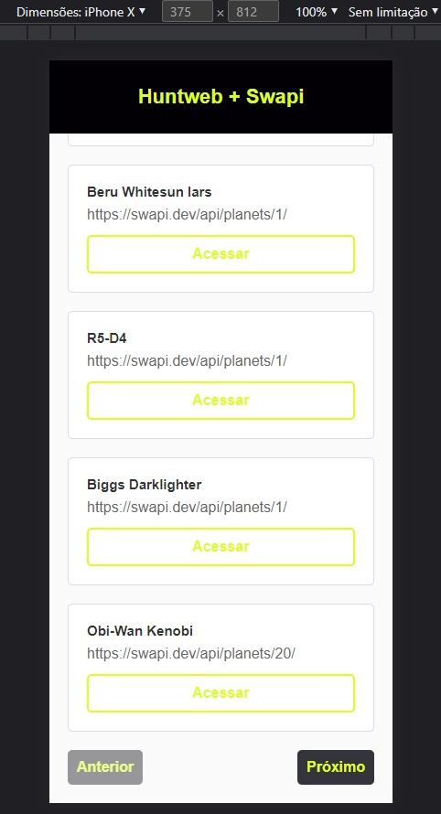
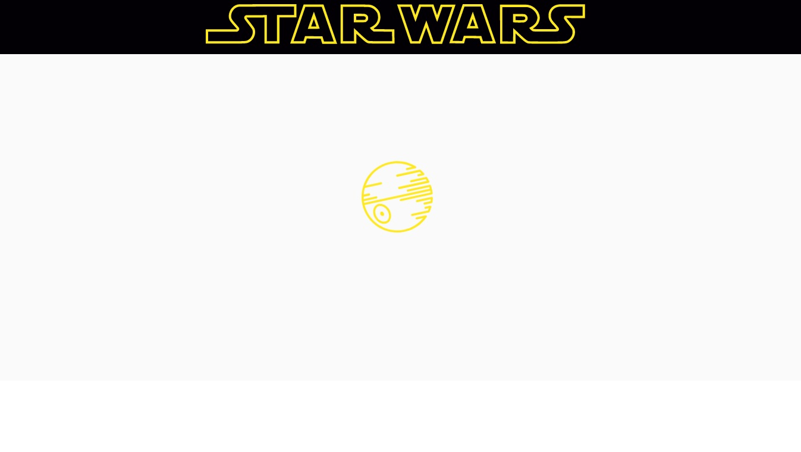
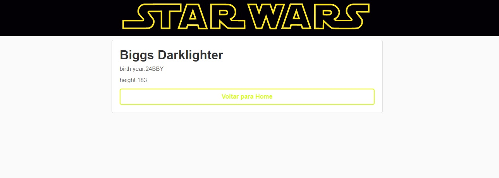
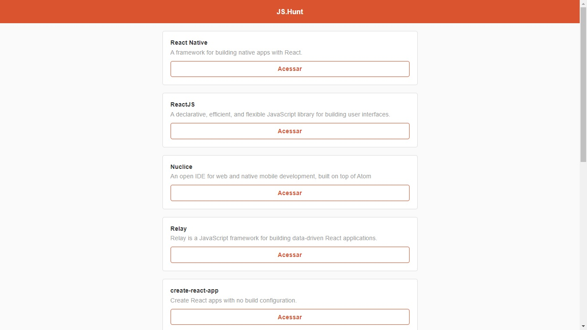

> **Projeto de estudo.** Estado conferido em 31/10/2026: os endereços que seguem fora do ar foram retirados deste README. Detalhes em [docs/AVALIACAO.md](docs/AVALIACAO.md) e próximos passos em [docs/PLANO-ESTRATEGICO.md](docs/PLANO-ESTRATEGICO.md).

<h4 align="center"> 
	🚧 Huntweb Swapi 🚀
</h4>

<h1 align="center">
    
</h1>

## Estado e próximos passos (ciclo de 03/11/2026)

Sem site publicado: o GitHub Pages não está ligado, e `douglasabnovato.github.io/huntweb-swapi/` dá 404 em 06/11/2026 ([#25](https://github.com/douglasabnovato/huntweb-swapi/issues/25)). Para ver o projeto, rode localmente.

**O que foi feito**
- Limite de tempo e mensagens de falha da SWAPI, com testes ([#31](https://github.com/douglasabnovato/huntweb-swapi/pull/31)).
- "Tentar de novo" no detalhe e filmes do personagem, com testes ([#31](https://github.com/douglasabnovato/huntweb-swapi/pull/31)).
- Código antigo apagado e CI também na `developer` ([#31](https://github.com/douglasabnovato/huntweb-swapi/pull/31)).
- MVP de estudo registrado na régua N1 ([#22](https://github.com/douglasabnovato/huntweb-swapi/pull/22)).
- Licença MIT ([#21](https://github.com/douglasabnovato/huntweb-swapi/pull/21)) e README sem endereços fora do ar ([#17](https://github.com/douglasabnovato/huntweb-swapi/pull/17)).

**O que queremos fazer**
- [#25](https://github.com/douglasabnovato/huntweb-swapi/issues/25) Ligar o GitHub Pages e publicar o site (responsável).
- [#26](https://github.com/douglasabnovato/huntweb-swapi/issues/26) Proteger a `master` com PR e CI obrigatórios (responsável).
- [#27](https://github.com/douglasabnovato/huntweb-swapi/issues/27) API de reserva quando a swapi.dev cai.
- [#28](https://github.com/douglasabnovato/huntweb-swapi/issues/28) Páginas de planetas, espécies e naves.
- [#29](https://github.com/douglasabnovato/huntweb-swapi/issues/29) Teste de navegador do fluxo buscar, abrir e voltar.
- [#30](https://github.com/douglasabnovato/huntweb-swapi/issues/30) Atualizar o README com o que o projeto usa hoje.

**Onde está a documentação**
- Estado e critérios: [docs/MVP.md](docs/MVP.md).
- Plano do ciclo: [docs/PLANO-DE-ACAO.md](docs/PLANO-DE-ACAO.md), seção "Ciclo de 03/11/2026".

## 🧠 O que aprendi

> Proposta de 01/11/2026, escrita a partir do código e das dependências. Ajuste com a sua experiência.

- Consumir uma API pública e paginar resultados em React.
- Configurar a URL da API por variável de ambiente.
- Navegar entre lista e detalhe com React Router.
- Testar a interface com Vitest.

## 💻 Sobre o projeto

Projeto para consumir informações do star wars da api swapi e exibir no frontend desenvolvido em reactjs. Permite acessar uma introdução de cada item ao clicá-lo.
O que mais gosto desse projeto é que foi o meu primeiro bootcamp e o meu primeiro desafio contendo frontend consumindo uma API.

#### Nova Api Swapi

- [swapi](https://swapi.dev/), [swapi infos](https://swapi.dev/about), [swapi documentation](https://swapi.dev/documentation) 
- `https://swapi.dev/api/`
- rotas das informações da swapi
````json
{
    "people": "https://swapi.dev/api/people/", 
    "films": "https://swapi.dev/api/films/", 
    "vehicles": "https://swapi.dev/api/vehicles/",
    "planets": "https://swapi.dev/api/planets/",  
    "species": "https://swapi.dev/api/species/", 
    "starships": "https://swapi.dev/api/starships/"
}
````
- utilizar informações no arquivo json: planets, species, starships

### 💻 Tópicos

A seguir, listei os tópicos abordados para construir o projeto original.

A versão atual do projeto sofreu algumas modificações no que implica a forma como estão sendo realizados os itens listadas.

#### 1. O que é ReactJS ?

- [x] 1.1. ReactJS construir o Frontend
- [x] 1.2. uma biblioteca para desenvolver em javascript
- [x] 1.3. Acessar API Rest
- [x] 1.4. Roteamento
- [x] 1.5. Componentes
- [x] 1.6. Estados e Propriedades

#### 2. Criando Projeto

- [x] 2.1. `node -v`
- [x] 2.2. `npm -v`
- [x] 2.3. `yarn -v`
- [x] 2.4. `create-react-app huntweb`
- [x] 2.5. `cd huntweb`
- [x] 2.6. `code .`
- [x] 2.7. `npm start`

#### 3. O que são componentes ?

- [x] 3.1. conceito de componentização
- [x] 3.2. react
- [x] 3.3. react-dom 
- [x] 3.4. método do componente: render

#### 4. Criando Header ?

- [x] 4.1. na pasta src, na pasta componentes, na pasta Header, então criar todos arquivos desse componente: index.js
- [x] 4.2. Estilização do component Header: styles.css
- [x] 4.3. Estilização global 

#### 5. Buscando produtos da API 

- [x] 5.1. acessar API Rest feita em nodejs e exibir na nossa tela em ReactJS.
- [x] 5.2. fiz essa api no repositório nodejs-api
- [x] 5.3.1. essa API Rest fornece o dados dos produtos: id, title, description, url, ( createdAt, não será exibido) 
- [x] 5.3.2. informações de paginação: docs, total, limit, page, pages
- [x] 5.4. biblioteca axios: `yarn add axios`: permite acessar um endereço externo: pasta services/api.js
- [x] 5.5. A URL da nossa API: `http://rocketseat-node.herokuapp.com/api`
- [x] 5.6. Insomnia: usar essa aplicação para gerir os dados da api
- [x] 5.7. Na api, os produtos estão dentro da informação `docs` 
- [x] 5.8. A busca dessas informações na api será realizada pelo main/index.js.

#### 6. Armazenamento no estado

- [x] 6.1. state, estado, acredito ser o principal conceito do reactjs
- [x] 6.2. o react trabalha com variável state e não variável normal. 
- [x] 6.3. o `estado` trabalha em manipular a variável objeto

#### 7. Listando produtos

- [x] 7.1. estilizar a exibição dos produtos

#### 8. Páginas anterior / próxima

- [x] 8.1. fazer a paginação dos produtos
- [x] 8.2. criar os botões: anterior e próximo
- [x] 8.3. estilização dos botões
- [x] 8.4. chamar um método toda vez que o usuário clicar no botão

#### 9. Configurando Navegação (Roteamento)

- [x] 9.1. Usar rotas para a navegação: `yarn add react-router-dom`
- [x] 9.2. Componente de detalhes dos produtos: browserrouter, switch, route 
- [x] 9.3. Redirecionar o usuário conforme cada rota
- [x] 9.4. Componente Link para cada um dos botões

#### 10. Navegando para o detalhe

- [x] 10.1. Buscar os dados dos produtos da API Rest
- [x] 10.2. Exibir em tela na pages products
- [x] 10.3.1. state
- [x] 10.3.2. async await
- [x] 10.3.3. props 
- [x] 10.3.4. componentdidmount
- [x] 10.4. Estilização da product info

---

### Próximo passo para frontend

- [ ] 1. responsividade
- [ ] 2. acessibilidade
- [ ] 3. modo dark / light
- [ ] 4. variação de cores
- [ ] 5. hospedar aplicação

---

#### Encerramos 

Componentização, roteamento, ciclos de vida, utilização de API Rest, estado. 

## 🎨 Layout

Uma aplicação web que requisita informações de uma API

### Web - v3.1 (ciclo de 03/11/2026)

- [x] Falha da SWAPI testada: rede caída, servidor fora do ar e tempo esgotado (15 s) têm mensagem
- [x] "Tentar de novo" também no detalhe do personagem
- [x] Filmes do personagem no detalhe, sem nova chamada à API
- [x] Saiu o código antigo (`src/routes.js`, `src/services/api.js` com axios, `public/index.html`)
- [x] CI também nos PRs para `developer/**`

### Próximos passos

- Ligar o GitHub Pages e publicar (responsável)
- Proteger a `master` com PR e CI obrigatórios (responsável)
- API de reserva quando a swapi.dev cai
- Páginas de planetas, espécies e naves
- Teste de navegador e README atualizado

As issues abertas têm os critérios de cada item.

### Web - v3.0 (revisão de qualidade)

- [x] Link do personagem corrigido para qualquer id (antes quebrava em ids de 1 e 3 dígitos)
- [x] Planeta natal mostra o nome (usa `src/data/planets.json` e busca os que faltam)
- [x] Busca por nome, página na URL, detalhe com mais dados e página 404
- [x] Mensagens de erro com "Tentar de novo" (antes o carregamento ficava eterno)
- [x] Contraste AA, rótulos e foco visível (axe-core sem violações)
- [x] Vite 8 + React 18 + React Router 7; testes com Vitest; `npm audit` sem alertas
- Detalhes em [docs/ANALISE.md](docs/ANALISE.md), [docs/ARQUITETURA.md](docs/ARQUITETURA.md) e [docs/PLANO-DE-ACAO.md](docs/PLANO-DE-ACAO.md)

### Web - v2.0

- [x] favicon da star wars: insirido as imagens na pasta public
- [x] fluxo da rota
- [x] componente de loader para o elemento people clicado
- [x] paginação de objetos
- [x] estilização de item clicado
- [x] header fixed
- [x] header logo
- [x] tratar paginação no fluxo para page > 1 (Navegação (Roteamento))
- [x] o botão voltar (Navegação (Roteamento))
- [x] [reactrouter](https://v5.reactrouter.com/web/guides/quick-start)
- [x] inspiração [starwars-visualguide](https://starwars-visualguide.com/#/)
- [x] inspiração [tbone849-star-wars-guide](https://github.com/tbone849/star-wars-guide)
- [x] inspiração [swapi-task](https://finmavis.github.io/swapi-task/)
- [x] inspiração [finmavis-swapi-task](https://github.com/finmavis/swapi-task)
- [x] inspiração [animatk-ReactJS-Star-Wars-API](https://github.com/animatk/ReactJS-Star-Wars-API)

<h5 align="center"> 
	🚀 mudança da api para `https://swapi.dev.api`
</h5>

<p align="center" style="display: flex; align-items: flex-start; justify-content: center;">
  
  
  
  
</p>

### Web - v1.0

<h5 align="center"> 
	🚀 api `http://rocketseat-node.herokuapp.com/api`
</h5>

<p align="center" style="display: flex; align-items: flex-start; justify-content: center;">
  
</p> 

## 🛠 Tecnologias

As seguintes ferramentas foram usadas na construção do projeto:

- [Css][css]: posicionamento, dimensionamento e muito mais
- [Javascript][javascript]
- [HTML][html]: estrutura e efeitos 
- [React][reactjs]: os fundamentos, como state, props, components, ciclo de vida.
- [Git][git]
- [Github][github] 
- [Yarn][yarn]
- [Node.js][nodejs]
- [Zeit Now](https://vercel.com/) 

## 🚀 Como executar o projeto

```bash
git clone https://github.com/douglasabnovato/huntweb-swapi
cd huntweb-swapi
npm install
npm run dev      # http://localhost:5173
npm test         # testes com Vitest
npm run build    # gera build/ (publicado no GitHub Pages pelo workflow)
```

A URL da API pode ser trocada em `.env` (`VITE_SWAPI_URL`) e, no site publicado, pela variável de repositório `VITE_SWAPI_URL`. Só funciona com uma API no mesmo formato da swapi.dev (lista paginada com `count`, `next`, `results` e busca por `?search=`); veja [docs/DEPLOY.md](docs/DEPLOY.md).

### Publicação

- Fora do ar desde a conferência de 31/10/2026; para ver o projeto, rode localmente (seção "Como executar o projeto").
- Hospedagem prevista: GitHub Pages (gratuito), publicado pelo GitHub Actions a cada push na `master`
- Passo a passo: [docs/DEPLOY.md](docs/DEPLOY.md)

## 😯 Como contribuir para o projeto

1. Faça um **fork** do projeto.
2. Crie uma nova branch com as suas alterações: `git checkout -b my-feature`
3. Salve as alterações e crie uma mensagem de commit contando o que você fez: `git commit -m "feature: My new feature"`
4. Envie as suas alterações: `git push origin my-feature`
> Caso tenha alguma dúvida confira este [guia de como contribuir no GitHub](https://github.com/firstcontributions/first-contributions)

## 📝 Licença

Este projeto esta sobe a licença MIT.

Feito com ❤️ por Douglas A B Novato 👋🏽 [Entre em contato!](https://www.linkedin.com/in/douglasabnovato/)

Fonte do projeto: [Rocketseat Discover - ReactJS](https://www.rocketseat.com.br/)

[git]: https://git-scm.com/doc
[github]: https://docs.github.com/en
[nodejs]: https://nodejs.org/
[reactjs]: https://reactjs.org
[yarn]: https://yarnpkg.com/
[vscode]: https://code.visualstudio.com/
[css]: https://developer.mozilla.org/en-US/docs/Web/CSS 
[html]: https://developer.mozilla.org/en-US/docs/Web/HTML
[javascript]: https://developer.mozilla.org/en-US/docs/Web/JavaScript 
