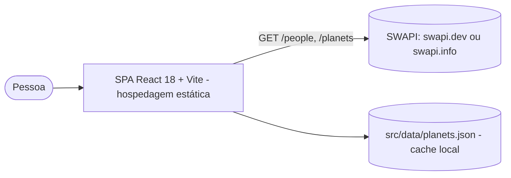
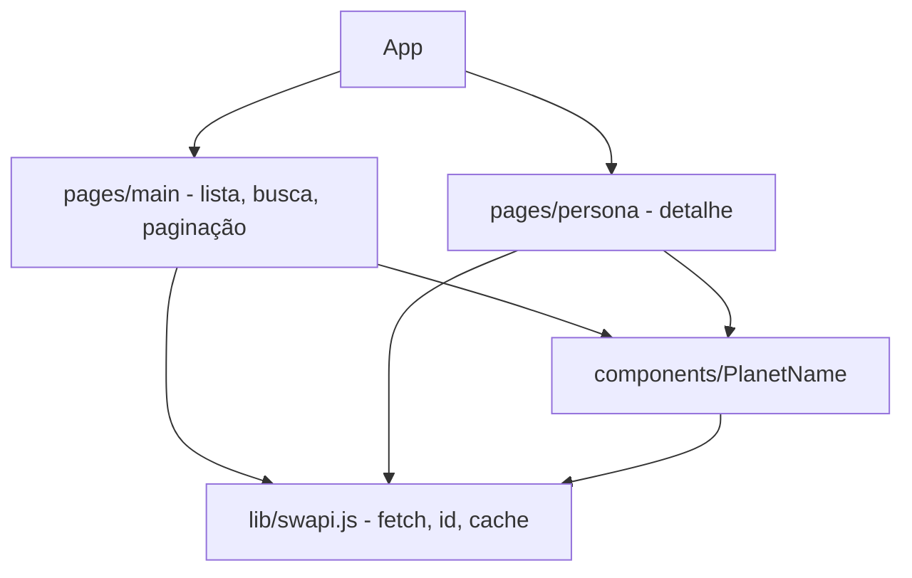

# Arquitetura — Huntweb SWAPI

## ADRs

| # | Decisão | Motivo | Alternativa |
|---|---|---|---|
| ADR-01 | `fetch` nativo em vez de axios | Menos dependências; axios 0.18 tinha alertas | Atualizar axios |
| ADR-02 | Página e busca na URL (`?page=&q=`) | Voltar do detalhe mantém a posição; links compartilháveis | Estado só em memória |
| ADR-03 | Cache de planetas com o JSON local + memória | Evita 1 requisição por cartão | Buscar sempre |
| ADR-04 | URL da API por `VITE_SWAPI_URL` | A swapi.dev já ficou fora do ar; swapi.info é espelho | URL fixa |
